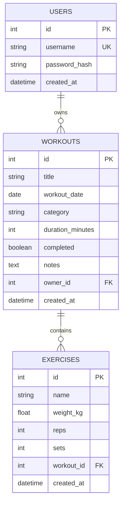
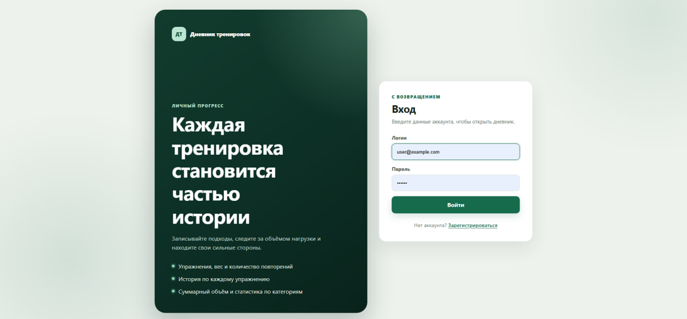
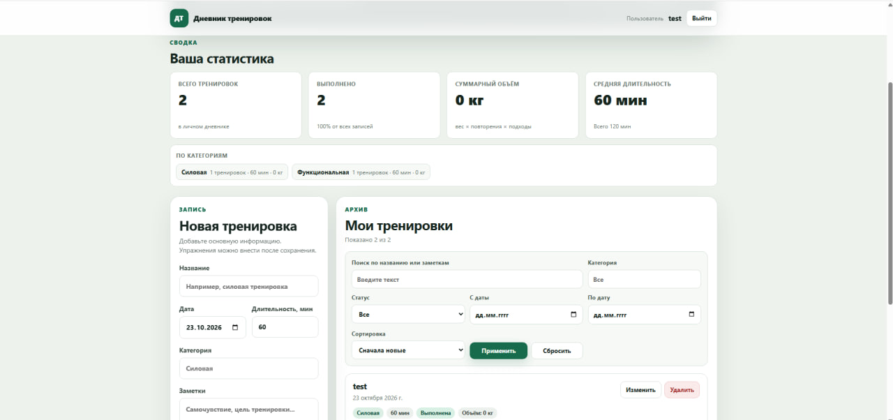
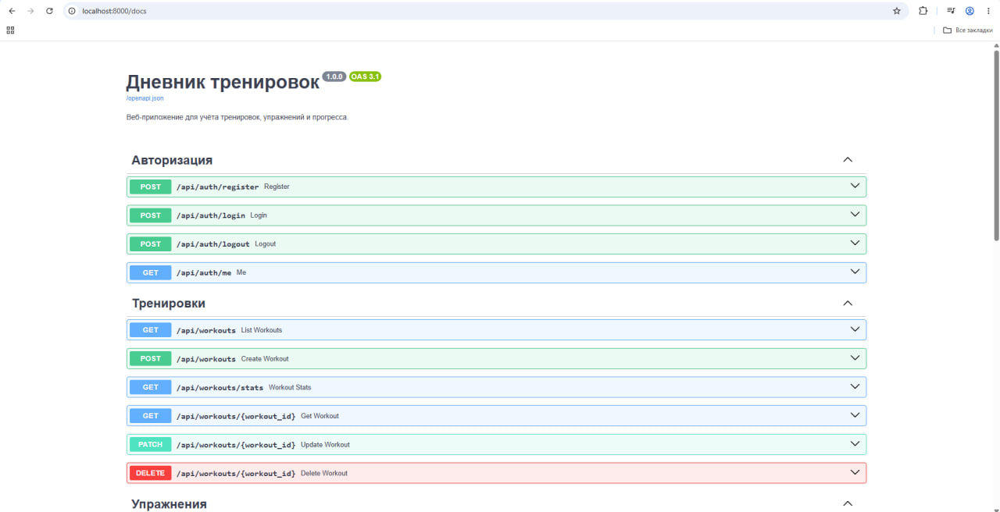

# Дневник тренировок

**Тема:** клиент-серверное веб-приложение для ведения дневника тренировок
**Вариант:** «Дневник тренировок»: тренировка, упражнение с весом и повторениями, история по упражнению, суммарный объём

Приложение позволяет зарегистрироваться, войти в личный кабинет и вести учёт тренировок. Каждая тренировка содержит упражнения с весом, количеством повторений и подходов. Для упражнений доступна история, а статистика рассчитывает суммарный объём нагрузки.

## Возможности

- регистрация, вход и выход с помощью подписанной сессионной cookie;
- хранение паролей только в виде PBKDF2-хеша с индивидуальной солью;
- изоляция данных: пользователь видит, изменяет и удаляет только свои записи;
- полный CRUD тренировок;
- добавление, просмотр и удаление упражнений;
- история по названию упражнения;
- поиск по названию и заметкам, фильтры по категории, статусу и периоду;
- сортировка и пагинация;
- статистика: количество, сумма, среднее и группировка по категориям;
- адаптивный интерфейс для работы с телефона шириной от 360 px;
- состояния загрузки, пустого списка и ошибок API.

## Технологии

- Python 3.11
- FastAPI, APIRouter, Pydantic 2
- SQLAlchemy 2.0 (`Mapped`, `mapped_column`, `select`, `insert`, `update`, `delete`)
- SQLite
- Alembic
- Starlette `SessionMiddleware`
- HTML, CSS, JavaScript без фреймворков
- Git

## Структура проекта

```text
project/
├── app/
│   ├── main.py
│   ├── config.py
│   ├── database.py
│   ├── models.py
│   ├── schemas.py
│   ├── security.py
│   ├── deps.py
│   └── routers/
│       ├── auth.py
│       ├── workouts.py
│       └── exercises.py
├── static/
│   ├── index.html
│   ├── login.html
│   ├── register.html
│   ├── css/styles.css
│   └── js/
├── migrations/
│   ├── env.py
│   └── versions/0001_initial.py
├── alembic.ini
├── requirements.txt
├── README.md
└── .gitignore
```

## Схема базы данных



Связи:

- `users.id → workouts.owner_id` — один пользователь владеет многими тренировками;
- `workouts.id → exercises.workout_id` — одна тренировка содержит много упражнений.

Объём одного упражнения: `weight_kg × reps × sets`. Объём тренировки — сумма объёмов её упражнений.

## Установка и запуск

### Windows PowerShell

```powershell
python -m venv venv
.\venv\Scripts\Activate.ps1
python -m pip install --upgrade pip
pip install -r requirements.txt
$env:SECRET_KEY = "замените-на-длинную-случайную-строку"
alembic upgrade head
uvicorn app.main:app --reload
```

Если активация виртуального окружения запрещена политикой PowerShell:

```powershell
venv\Scripts\python.exe -m pip install -r requirements.txt
$env:SECRET_KEY = "замените-на-длинную-случайную-строку"
venv\Scripts\alembic.exe upgrade head
venv\Scripts\uvicorn.exe app.main:app --reload
```

### Linux / macOS

```bash
python3 -m venv venv
source venv/bin/activate
python -m pip install --upgrade pip
pip install -r requirements.txt
export SECRET_KEY="замените-на-длинную-случайную-строку"
alembic upgrade head
uvicorn app.main:app --reload
```

Случайный ключ для `SECRET_KEY`:

```powershell
python -c "import secrets; print(secrets.token_hex(48))"
```

Приложение: <http://127.0.0.1:8000>
Swagger UI: <http://127.0.0.1:8000/docs>

Если `SECRET_KEY` не задан, при запуске создаётся случайный ключ. В этом случае после перезапуска сервера старые сессии становятся недействительными.

База данных `app.db` создаётся только командой `alembic upgrade head`. Файл базы и виртуальное окружение исключены из Git.

## Переменные окружения

| Переменная | Назначение | Значение по умолчанию |
|---|---|---|
| `SECRET_KEY` | подпись сессионной cookie | случайные 96 hex-символов |
| `DATABASE_URL` | адрес базы данных | `sqlite:///./app.db` |
| `SESSION_COOKIE_NAME` | имя cookie сессии | `training_diary_session` |
| `SESSION_MAX_AGE` | время жизни сессии в секундах | `604800` |
| `COOKIE_SECURE` | передавать cookie только по HTTPS (`1`) | `0` |

## API

Все эндпоинты, кроме страниц, регистрации и входа, требуют активной сессии. При отсутствии сессии возвращается `401`.

### Авторизация

| Метод | Путь | Описание | Успешный ответ |
|---|---|---|---|
| POST | `/api/auth/register` | регистрация и автоматический вход | `201`, пользователь |
| POST | `/api/auth/login` | вход | `200`, пользователь |
| POST | `/api/auth/logout` | выход | `204` |
| GET | `/api/auth/me` | текущий пользователь | `200`, пользователь |

### Тренировки

| Метод | Путь | Описание | Успешный ответ |
|---|---|---|---|
| GET | `/api/workouts` | список с поиском, фильтрами, сортировкой и пагинацией | `200`, `{items, total, limit, offset}` |
| POST | `/api/workouts` | создание | `201`, тренировка |
| GET | `/api/workouts/stats` | статистика пользователя | `200` |
| GET | `/api/workouts/{id}` | одна тренировка | `200`, тренировка |
| PATCH | `/api/workouts/{id}` | частичное изменение | `200`, тренировка |
| DELETE | `/api/workouts/{id}` | удаление | `204` |

Параметры списка:

- `q` — поиск по названию и заметкам через `ilike`;
- `category` — фильтр по категории;
- `completed` — `true` или `false`;
- `date_from`, `date_to` — период по дате тренировки;
- `sort_by` — `date`, `title`, `duration` или `created`;
- `order` — `asc` или `desc`;
- `limit` — от 1 до 100;
- `offset` — смещение.

### Упражнения

| Метод | Путь | Описание | Успешный ответ |
|---|---|---|---|
| GET | `/api/workouts/{workout_id}/exercises` | список упражнений тренировки | `200` |
| POST | `/api/workouts/{workout_id}/exercises` | добавление упражнения | `201` |
| GET | `/api/exercises/history?name=...` | история по названию упражнения | `200` |
| DELETE | `/api/exercises/{id}` | удаление упражнения | `204` |

Чужая тренировка или упражнение возвращает `404`. Идентификатор владельца всегда берётся из сессии и не передаётся клиентом.

## Проверка работы

1. Откройте главную страницу — без входа произойдёт перенаправление на `/login`.
2. Зарегистрируйте пользователя, затем выйдите и войдите снова.
3. Создайте тренировку с названием, датой, категорией, длительностью и заметкой.
4. Добавьте к тренировке упражнение: название, вес, повторения и подходы.
5. Проверьте суммарный объём, поиск, фильтры, сортировку и кнопку «Показать ещё».
6. Нажмите «История» у упражнения и проверьте агрегированные показатели.
7. Измените и удалите тренировку, удалите упражнение.
8. Убедитесь, что второй пользователь не видит записи первого.
9. Проверьте Swagger UI на `/docs` и коды `201`, `204`, `401`, `404`, `422`.

## Скриншоты интерфейса

### Страница входа



### Страница регистрации


### Главная страница



### Документация API в Swagger



## Безопасность

- пароли хранятся как PBKDF2-HMAC-SHA256 с 390 000 итераций и случайной 16-байтовой солью;
- пароль и `password_hash` отсутствуют в ответах API;
- cookie сессии подписывается `SECRET_KEY`, имеет `HttpOnly` и `SameSite=Lax`;
- все запросы к данным используют `Depends(get_current_user)`;
- каждый запрос к тренировкам и упражнениям ограничен `owner_id` текущего пользователя;
- `owner_id` не принимается из формы или JSON;
- поиск, фильтры и пагинация выполняются на стороне сервера;
- пользовательский текст выводится через `textContent`, без вставки HTML;
- секретный ключ не хранится в репозитории.

